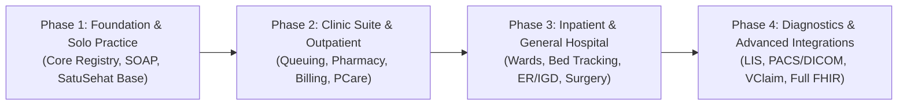

# Mangotek Health Suite — Agent & AI Developer Operating Guidelines (AGENTS.md)

> **Mandatory Operating Standards for AI Coding Agents, Contributors, and Automation Bots**  
> **Applies to:** Odoo 18.0+, Community & Enterprise Architecture  
> **License:** LGPL-3.0 · **Organization:** Mangotek Healthcare Cloud

---

## 1. Prime Directive: Zero AI Slop & High-Integrity Engineering

As an AI agent developing for **Mangotek Health Suite**, your primary objective is to produce production-grade, maintainable, and clinically safe code that feels as if it were authored by senior Odoo core engineers. Generic AI placeholders, hallucinations, bloated boilerplate, and superficial comments are strictly forbidden.

### Core Agent Tenets
1. **Never Touch What Isn't Broken**: When modifying existing code, make surgical, precise edits. Do not rewrite surrounding functions or reformat unrelated lines.
2. **Deterministic Architecture**: Always ground decisions on official Odoo 18 ORM patterns and Indonesian statutory health standards (PMK 24/2022, SatuSehat HL7 FHIR, BPJS Kesehatan).
3. **No Phantom Imports / No Mock Hallucinations**: Every dependency must exist in Odoo 18 core or within the suite's manifest declarations. Never invent third-party pip packages when standard libraries or Odoo tools suffice.
4. **Clinical Safety & Legal Compliance**: Healthcare software deals with real patient lives and strictly governed private health data. Code must be verifiable, auditable, and resilient to failure.

---

## 2. Phased Roadmap Execution & Milestone Governance (MANDATORY)

All AI agents and developers working on this codebase **MUST** understand and respect the 4-phase master roadmap. You must never jump ahead to complex hospital modules (e.g. Inpatient, Surgery, or PACS) before the foundational patient and clinical models in prior phases are rock-solid.



### Strict Phase Sequencing & Module Ownership:
1. **Phase 1: Core Foundation & Solo Practice (TPMD)**
   - **`health_base`**: Patient registry (`health.patient`), doctors (`health.physician`), departments (`health.department`), ICD-10 & ICD-9 CM seeds. *This is the root anchor for the entire suite.*
   - **`health_emr`**: Universal SOAP (`health.emr.soap`), vital signs (`health.vital.sign`), medical certificates.
   - **`health_api_base`**: RESTful API endpoints (`/api/v1/health/...`) for headless clinician charting.
   - **`health_satusehat_base`**: OAuth2 client connector, NIK to IHS resolution, FHIR `Encounter` and `Condition`.
2. **Phase 2: Outpatient Clinics, Pharmacy & Financial Engine**
   - **`health_appointment`**: Patient admission, clinic rosters, queue tickets, TV display engine.
   - **`health_emr_specialty`**: Dental Odontogram and Maternal & Child Health (MCH/KIA).
   - **`health_pharmacy`**: e-Prescriptions, drug compounding, FEFO lot picking (`stock.lot`), prescription labels.
   - **`health_billing`**: Centralized billing aggregator, multi-tariff fee split, dynamic QRIS, sync with `account.move`.
   - **`health_bpjs_pcare`**: BPJS PCare Web Service integration for primary care facilities.
3. **Phase 3: Full-Scale Hospital Operations (Inpatient, Bed & ER)**
   - **`health_inpatient`**: Ward/Room/Bed hierarchy, Bed Occupancy Rate (BOR) analytics, bed mutations, CPPT progress notes.
   - **`health_emergency`**: 24/7 Emergency Room (IGD) triage (ATS/ESI) and fast-track admissions.
   - **`health_surgery`**: Operating Room / OK booking, WHO Surgical Safety Checklist, anesthesia reports.
   - **`health_hospital_pharmacy`**: Multi-depot pharmacy logistics and patient medication returns.
4. **Phase 4: Diagnostic Support, Advanced Bridging & Hospital Analytics**
   - **`health_laboratory`**: Electronic lab orders, normal reference ranges, LIS analyzer bridging.
   - **`health_radiology`**: Medical imaging orders, radiologist reports, PACS/DICOM web viewer.
   - **`health_bpjs_vclaim`**: Hospital VClaim 2.0 SEP generation, SPRI, referral online, Mobile JKN queue sync.
   - **`health_inacbg`**: E-Klaim / INA-CBG casemix grouper bridging.
   - **`health_satusehat_full`**: Comprehensive FHIR suite (`Observation`, `DiagnosticReport`, `MedicationRequest`, `Procedure`).

### Rules for Agents During Implementation:
- **Check Current Sprint Phase**: When prompted to implement a feature, identify which Phase it belongs to. Do not add fields to downstream modules if the upstream parent module has not yet defined the core relation.
- **Preserve Stable Manifest Dependencies**: Follow the explicit dependency hierarchy (`health_emr` -> `health_base`, `health_pharmacy` -> `health_base` + `stock`, `health_billing` -> `health_base` + `account`).
- **Continuous Validation**: Always run `python scripts/validate_apps_store.py` after adding or editing any module manifest or assets.

---

## 3. Anti-Slop Code & Hygiene Standards

We enforce strict filters across code comments, UI design, and copywriting:

### A. Comment Hygiene (`antislop-code`)
- **NEVER** write comments that simply narrate what the code visibly does:
  ```python
  # BAD (AI Slop):
  # Loop through all lines
  for line in self.line_ids:
      # Add amount to total
      total += line.amount

  # GOOD (Clean, self-documenting):
  total = sum(self.line_ids.mapped('amount'))
  ```
- **ONLY** write comments that explain non-obvious business logic, clinical calculations, or regulatory compliance rationales:
  ```python
  # SATUSEHAT: Encounter status must be 'in-progress' before Condition (ICD-10) can be linked
  # per Kemenkes SatuSehat FHIR Interoperability Guide v1.2
  ```
- **NEVER** leave `# TODO: implement this later` or placeholder pass statements in deliverables. If a feature is declared, implement it completely.

### B. UI & Design Hygiene (`antislop-ui`)
- **Native Odoo Harmony**: Form views, Kanban views, and search filters must adhere 100% to native Odoo 18 XML structure.
- **No Skeuomorphic Clutter**: Do not invent custom CSS gradients, glossy drop-shadows, or glassmorphism bubbles. Use Odoo's native Bootstrap classes (`text-primary`, `badge rounded-pill`, `o_horizontal_separator`, `oe_title`).
- **Consistent Icons & Metrics**: Use FontAwesome 4 / 5 icons standard in Odoo (`fa-user-md`, `fa-stethoscope`, `fa-hospital-o`, `fa-medkit`, `fa-bed`).

### C. Copywriting Hygiene (`antislop-copywriting`)
- Avoid generic marketing buzzwords ("revolutionary", "cutting-edge", "seamless experience", "unparalleled power").
- Use clean, precise clinical and ERP terminology: "Patient Electronic Medical Record", "Prescription Dispensing", "Tariff Decomposition", "Inpatient Bed Mutation".

---

## 3. Healthcare Security & Regulatory Privacy Guidelines (`security-audit`)

All clinical and financial models must adhere strictly to patient privacy mandates (Indonesian Health Law PMK 24/2022 & General Data Protection principles):

### A. Strict Role-Based Access Control (RBAC)
- Every model (`_name = 'health.*'`) **MUST** have an entry in `security/ir.model.access.csv`.
- Implement hierarchical security groups in `security/health_security.xml`:
  1. `group_health_receptionist`: Pendaftaran & antrean pasien.
  2. `group_health_nurse`: Vital signs, asuhan keperawatan, dan skrining awal.
  3. `group_health_physician`: Full EMR clinical entry, diagnosis, and e-prescribing.
  4. `group_health_pharmacist`: Prescription review, dispensing, and inventory stock picking.
  5. `group_health_cashier`: Patient billing settlement and receipt generation.
  6. `group_health_manager`: Full administrative, master data, and configuration access.

### B. Record Rules & Multi-Company Isolation
- Ensure all clinical encounters and inpatient stays isolate data per hospital/clinic branch:
  ```xml
  <record id="health_encounter_comp_rule" model="ir.rule">
      <field name="name">Health Encounter multi-company</field>
      <field name="model_id" ref="model_health_encounter"/>
      <field name="domain_force">[('company_id', 'in', company_ids)]</field>
  </record>
  ```

### C. SQL Injection & Database Safety
- **NEVER** format raw SQL queries with string concatenation or f-strings:
  ```python
  # DANGEROUS / FORBIDDEN:
  self.env.cr.execute(f"SELECT id FROM health_patient WHERE nik = '{nik}'")

  # MANDATORY / SAFE:
  self.env.cr.execute(
      "SELECT id FROM health_patient WHERE nik = %s AND active = true",
      (nik,)
  )
  ```
- Favor Odoo ORM methods (`search`, `browse`, `filtered`) over raw SQL unless processing massive analytical queries.

### D. Audit Trails & Sensitive Data Protection
- Clinical notes (SOAP), diagnosis history, and medical records **MUST** track user signatures:
  - Inherit `mail.thread` and `mail.activity.mixin` on core clinical models (`health.encounter`, `health.emr.soap`, `health.prescription`).
  - Enable `tracking=True` on critical clinical fields (Diagnoses, Prescriptions, Bed transfers).
  - Passwords, SatuSehat API Client Secrets, and BPJS Consumer Secrets must be stored in `ir.config_parameter` with `is_password=True` or retrieved via secure system environment variables.

---

## 4. Brand & Asset Creation Guidelines for Agents

When generating module icons, SVG assets, and promotional covers:
1. **Follow `BRANDKIT.md`**: Strictly apply the official palette (Hospital Amethyst `#985184`, Emerald Mint `#1AD3BB`, Clinical Cyan `#088BF5`, Pharmacy Coral `#F86126`, Sunflower Gold `#FBB945`).
2. **Icon Grid**: Construct module launcher icons on a clean `50x50` vector canvas with mathematical 45°/60° facet geometry.
3. **Banner Architecture**: Module covers must be exactly `1200x630 px` PNG and generated via `scripts/generate_module_banners.py` to maintain unified typography, badge placement, and crisp visual hierarchy.
4. **No Third-Party Copyright Infringements**: Never embed external copyrighted logos (e.g. government seals or proprietary third-party branding) into open-source icons. Use generic, universally recognized geometric metaphors.

---

## 5. Odoo 18 Technical Coding Standards

### Models & ORM
- Use Python 3.12+ type annotations where applicable.
- Define explicit `_description` on every model.
- Always use `api.depends` on computed fields and specify `store=True` judiciously.
- Protect related fields with appropriate `ondelete` policies (`restrict` on vital foreign keys like patient or physician).
- Follow standard Odoo field order:
  1. Primary identification (`name`, `code`, `sequence`)
  2. Relational Many2one fields
  3. Relational One2many / Many2many fields
  4. Descriptive / Clinical fields
  5. Computed fields
  6. State & Status fields

### Views & Actions
- Every action window must have explicit `view_mode` (`list,form,kanban`).
- In Odoo 18, use `<list>` instead of `<tree>` for tabular views.
- Provide responsive mobile search views with sensible default filters and group-bys.

---

## 6. Strict Multi-App Interoperability & Zero-Conflict Protocol (MANDATORY)

> [!IMPORTANT]
> **COEXISTENCE GUARANTEE:** Mangotek Health Suite is designed to operate in diverse Odoo deployments alongside standard Enterprise/Community apps, localization packages, and third-party marketplace addons (including `odoo-finance`). Agents and developers **MUST** guarantee that no module in this suite causes naming, schema, view, or behavior conflicts with other apps.

### 1. Universal Model Namespacing (`_name`)
- **MANDATORY:** All custom models declared in this suite **MUST** begin with the `health.` namespace:
  - ✅ `health.appointment`, `health.prescription`, `health.billing`, `health.patient`, `health.vital.sign`
  - ❌ **STRICTLY FORBIDDEN:** Bare/generic model names like `appointment`, `billing`, `patient`, `doctor`, `invoice`, `hospital`, `prescription`. (Note: Odoo Enterprise already ships with an official `appointment` module — collision with it breaks Odoo's registry).

### 2. Field Namespacing on Core Model Inheritance (`_inherit`)
- When extending existing core Odoo models (`res.partner`, `res.company`, `product.product`, `product.template`, `account.move`, `stock.picking`):
  - Every custom injected field **MUST** be explicitly prefixed with `health_`:
    - ✅ `health_patient_id`, `health_is_medicine`, `health_billing_id`, `health_physician_id`
    - ❌ **FORBIDDEN:** Injecting bare names like `is_doctor`, `patient_id`, `doctor_id`, `consultation_fee` directly into `res.partner` or `account.move`.

### 3. XML Record ID & View Namespacing
- Every XML ID (`ir.ui.view`, `ir.actions.act_window`, `ir.ui.menu`, `ir.sequence`, `ir.rule`) **MUST** incorporate the module or model name:
  - ✅ `view_health_appointment_form`, `action_health_prescription_window`, `menu_health_billing_root`
  - ❌ **FORBIDDEN:** Generic IDs like `view_form`, `action_window`, `menu_root`, `appointment_tree`.

### 4. Robust XPath View Inheritance (No Fragile Positional Selectors)
- When inheriting views from other modules (such as `account.move` or `stock.picking`):
  - **NEVER** use positional xpath selectors (e.g. `/form/sheet/group[1]/field[2]` or `//page[3]`).
  - **ALWAYS** anchor on semantic attribute matches:
    ```xml
    <!-- Safe XPath Anchor -->
    <xpath expr="//field[@name='partner_id']" position="after">
        <field name="health_patient_id" optional="show"/>
    </xpath>
    ```
  - For new notebook tabs, always define a named `<page name="health_billing_tab" string="Healthcare Billing">` so other downstream addons can cleanly extend it.

### 5. Cooperative Method Overriding (Strict `super()` Compliance)
- When overriding standard ORM methods (`create`, `write`, `action_post`, `button_validate`, `unlink`):
  - Always call `super()` passing all arguments and keyword arguments.
  - Never swallow return values or break expected return types (e.g. actions, records, or booleans).
  - Ensure operations are idempotent to preserve compatibility across the Python Method Resolution Order (MRO).

### 6. PostgreSQL SQL Constraint Namespacing (`_sql_constraints`)
- PostgreSQL unique and check constraint names share the global schema namespace.
- All constraint identifiers **MUST** be prefixed with the module/model:
  - ✅ `_sql_constraints = [('health_patient_nik_unique', 'unique(nik)', 'NIK must be unique!')]`
  - ❌ **FORBIDDEN:** `_sql_constraints = [('nik_unique', 'unique(nik)', ...)]`

### 7. Soft Dependencies & Graceful Degradation
- When integrating with optional companion modules (such as `odoo-finance` modules `account_qris_qbiz`, `account_stamp_signature`, or `l10n_id_coretax_taxation`):
  - The suite **MUST NEVER** crash or throw `KeyError`/`AttributeError` if those modules are absent or uninstalled.
  - Check module state via ORM or safe attribute inspection before executing companion-specific logic:
    ```python
    # Safe Soft-Dependency Check
    if 'account_qris_qbiz' in self.env['ir.module.module']._installed():
        # Execute enhanced dynamic QRIS flow
        pass
    else:
        # Fall back gracefully to standard payment slip
        pass
    ```

### 8. Web QWeb & Asset Namespacing
- All CSS class names, QWeb templates, and JS classes must be prefixed with `health_` or `o_health_` (e.g. `.o_health_queue_badge`, `.o_health_triage_card`) to avoid CSS bleed or selector clashes with other theme/backend plugins.

---

## 7. Mandatory End-to-End (E2E) Testing Protocol (ZERO COMMIT WITHOUT PASSING E2E)

> [!CAUTION]
> **STRICT PRE-COMMIT GATE:** AI agents and developers are **STRICTLY FORBIDDEN** from executing `git commit` on any code changes until the full End-to-End (E2E) test suite passes with zero failures and zero errors. In healthcare ERP systems, broken model relations or invalid state machines directly jeopardize patient care workflows and financial balances.

### Core E2E Clinical Flows Required:
1. **Outpatient Patient Journey E2E Flow:**
   - Patient Admission & Registration (`health.patient` with auto-generating MRN sequence)
   - Polyclinic Queue Allocation (`health.appointment` queue ticket)
   - Doctor Consultation & Vital Signs (`health.vital.sign` with automated BMI compute)
   - SOAP Clinical Notes & Primary/Secondary ICD-10 Diagnosis Tagging (`health.emr.soap`)
   - Electronic Prescribing with active ingredient compounding (`health.prescription`)
   - Pharmacist Clinical Review & FEFO Batch Lot Stock Picking (`stock.picking`, `stock.lot`)
   - Centralized Patient Billing Settlement with Doctor Fee split (`health.billing`)
   - Automated Customer Invoice & Payment Reconciliation (`account.move`).

2. **Inpatient & Emergency Care E2E Flow:**
   - 24/7 Emergency Triage (`health.emergency` ATS/ESI Red/Yellow/Green/Black)
   - Fast-Track Inpatient Admission & Bed Allocation (`health.inpatient.stay`)
   - Real-time Bed Matrix & Bed Occupancy Rate (BOR) metric update
   - Inter-Ward Bed Transfer (mutation) with automated pro-rated tariff calculations
   - Collaborative CPPT (Integrated Patient Progress Notes) entries
   - Electronic Medical Discharge Summary generation.

3. **National Regulatory Interoperability E2E Flow:**
   - Clinical Encounter completion triggering FHIR payload construction
   - Asynchronous Outbox Queue persistence (`health.integration.log`)
   - Mock SatuSehat FHIR gateway response handling (HTTP 201 Created & IHS linking)
   - Mock BPJS PCare & VClaim 2.0 SEP generation validation.

### Mandatory Pre-Commit Execution Command:
Before running any `git commit`, the agent **MUST** run:
```bash
# 1. Execute full E2E and unit test suite (Must exit with code 0)
python tests/run_all_tests.py

# 2. Execute Odoo Apps Store 5.0 compliance audit (Must pass 88/88 checks)
python scripts/validate_apps_store.py
```
If either command reports a failure, the agent must fix the issue immediately before committing.

---

## 8. Pre-Commit Verification Checklist

Before reporting completion or creating any commit, agents must verify:
- [ ] **Zero-Conflict Audit:** All models begin with `health.`, all inherited fields start with `health_`, XML IDs are module-prefixed, and constraints are namespaced.
- [ ] **E2E Clinical Tests:** `python tests/run_all_tests.py` passes with zero failures and zero errors.
- [ ] **Store Compliance:** `python scripts/validate_apps_store.py` passes with 100% compliance.
- [ ] Code passes Python AST syntax checks without errors.
- [ ] Security access file (`ir.model.access.csv`) contains all models declared in `models/`.
- [ ] No raw unescaped SQL queries exist in codebase (all use safe parameter tuples).
- [ ] Manifest `__manifest__.py` complies with `PUBLISHING.md` standards.
- [ ] Module icon exists at `static/description/icon.png`.
