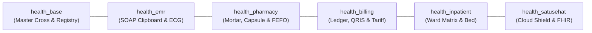

# Mangotek Health Suite — Brand Identity Kit (Brandkit)

> **Official Visual Identity, Design Tokens & Design System Guidelines for Odoo 18.0, 19.0 & 20.0 Healthcare Applications**  
> **Maintained by:** Mangotek Healthcare Cloud · **Contact:** `billing@ppti.me`  
> **License:** 100% Free & Open Source under [LGPL-3.0](LICENSE)

---

## 1. Brand Positioning & Visual Philosophy

**Mangotek Health Suite** is the premier open-source, modular Hospital Information System (HIS / SIMRS) and Electronic Medical Record (EMR) ecosystem built natively for **Odoo**.

### Brand Essence
* **Native Odoo Harmony:** Seamlessly mirrors the aesthetic elegance and clean ergonomics of native Odoo enterprise apps.
* **Clinical Authority & Trust:** Grounded in statutory health governance, clinical safety, and data precision.
* **Democratic Open Source:** 100% free and open-source under LGPL-3.0 for hospitals, clinics, and doctors worldwide.
* **Anti-Slop Craftsmanship:** Pure vector geometry, mathematical $45^\circ / 60^\circ$ facet polygons, and intentional typography. Zero generic AI bubbles, zero glossy skeuomorphism.

---

## 2. Master Logo Anatomy: The Healthcare Geometric Prism

The master brandmark of **Mangotek Health Suite** integrates the iconic MangoTek squircle prism with the international symbol of medicine and wellness: a faceted medical cross intersecting an ascending leaf prism.

```
          [ Amethyst Plum #985184 ] --- [ Sunflower Gold #FBB945 ]
                     \                      /
                      \                    /
                    [ Medical Cross Facet ]
                     [ Emerald Mint #1AD3BB ]
                     [ Shadow #005E7A ]
                      /                    \
                     /                      \
         [ Vital Coral #F86126 ] --- [ Royal Azure #088BF5 ]
```

### Geometric Principles (V2 Native Odoo Harmony)
1. **Full-Bleed Canvas Scale:** The primary graphic fills $90\% - 95\%$ of the $50 \times 50$ canvas (`x=3..47, y=3..47`), eliminating awkward floating padding and ensuring strong, prominent visual presence in the Odoo 9-dots app drawer.
2. **Multi-Colored Layered Gradients:** Each icon combines harmonious duotone/tritone gradients (Amethyst Plum, Emerald Teal, Sky Azure, Sunflower Amber, Vivid Coral) with overlapping translucent facet planes.
3. **Ergonomic Soft Radii:** Rounded corners ($rx=3..8$) deliver a modern, tactile app tile aesthetic that feels completely native to Odoo 18.0 Enterprise & Community.
4. **Crisp Mathematical Silhouette:** Instantly distinguishable at both $16\text{px}$ favicon scale and $512\text{px}$ high-resolution retina screens.

---

## 3. Official Color Palette & Healthcare Design Tokens

The color system directly harmonizes with Odoo's official corporate palette and the `odoo-finance` suite, infused with clinical emerald, vital amber, and diagnostic azure tones:

| Role | Color Name | Hex Code | RGB | Semantic Healthcare Function |
|:---|:---|:---|:---|:---|
| **Primary Odoo** | Amethyst Aubergine | `#985184` | `rgb(152, 81, 132)` | Odoo heritage, clinical administration, master patient registry |
| **Healing Accent** | Emerald Mint | `#1AD3BB` | `rgb(26, 211, 187)` | Wellness, SatuSehat compliance, validated clinical records |
| **Diagnostic Tech** | Royal Azure | `#088BF5` | `rgb(8, 139, 245)` | Digital EMR, laboratory analyzer feeds, medical imaging (PACS) |
| **Vital & Triage** | Mango Coral / Red | `#F86126` | `rgb(248, 97, 38)` | Emergency triage (Red/Yellow), critical vital signs alerts, pharmacy |
| **Gold Standard** | Sunflower Amber | `#FBB945` | `rgb(251, 185, 69)` | Healthcare quality accreditation (KARS), active bed status |
| **Light Highlight** | Sky Cyan | `#2EBCFA` | `rgb(46, 188, 250)` | Secondary highlights, digital queue flow arrows, pulse lines |
| **Depth Shading** | Deep Petrol Slate | `#005E7A` | `rgb(0, 94, 122)` | Facet shading, high-contrast borders, technical elements |
| **Canvas Dark** | Midnight Navy | `#0B0F19` | `rgb(11, 15, 25)` | Hero banners, dark mode backgrounds, store cover backdrops |

---

## 4. Module Iconography System

Each module in the Mangotek Health Suite possesses a distinct, cohesive $50 \times 50$ vector icon adhering to the master design rules:



### 1. `health_base` (Patient & Practitioner Master Registry)
* **Visual Metaphor:** Symmetric healthcare cross centered over an administrative folio with an ascending geometric identification badge.
* **Palette:** Amethyst Aubergine (`#985184`), Emerald Mint (`#1AD3BB`), Sunflower Gold (`#FBB945`), Deep Petrol (`#005E7A`).
* **Source:** `health_base/static/description/icon.png`

### 2. `health_emr` (Universal Clinical SOAP & Vital Signs)
* **Visual Metaphor:** Clinical clipboard folio intersected by an ascending dynamic ECG cardiac waveform and stethoscope curve.
* **Palette:** Royal Azure (`#088BF5`), Sky Cyan (`#2EBCFA`), Emerald Mint (`#1AD3BB`), Amethyst Aubergine (`#985184`).
* **Source:** `health_emr/static/description/icon.png`

### 3. `health_appointment` (Admission & Queue Orchestration)
* **Visual Metaphor:** Polyclinic entrance portal with a numbered queue ticket token and digital flow dispatch arrows.
* **Palette:** Sky Cyan (`#2EBCFA`), Emerald Mint (`#1AD3BB`), Sunflower Amber (`#FBB945`), Deep Petrol (`#005E7A`).
* **Source:** `health_appointment/static/description/icon.png`

### 4. `health_pharmacy` (e-Prescribing & Dispensary Management)
* **Visual Metaphor:** Precision apothecary mortar & pestle overlapping a dual-tone pharmaceutical capsule with a batch lot ring.
* **Palette:** Mango Coral (`#F86126`), Sunflower Gold (`#FBB945`), Emerald Mint (`#1AD3BB`), Deep Petrol (`#005E7A`).
* **Source:** `health_pharmacy/static/description/icon.png`

### 5. `health_billing` (Hospital Billing & Financial Aggregator)
* **Visual Metaphor:** Itemized healthcare invoice folio stamped with an official QRIS checkout badge and dual currency balance scales.
* **Palette:** Amethyst Aubergine (`#985184`), Emerald Mint (`#1AD3BB`), Royal Azure (`#088BF5`), Sunflower Amber (`#FBB945`).
* **Source:** `health_billing/static/description/icon.png`

### 6. `health_inpatient` (Ward, Room & Bed Management)
* **Visual Metaphor:** Multi-story hospital ward building silhouette framing an active clinical inpatient bed with an occupancy status indicator.
* **Palette:** Royal Azure (`#088BF5`), Sunflower Gold (`#FBB945`), Emerald Mint (`#1AD3BB`), Amethyst Aubergine (`#985184`).
* **Source:** `health_inpatient/static/description/icon.png`

### 7. `health_emergency` (Emergency Department 24/7 / IGD)
* **Visual Metaphor:** Bold eight-pointed emergency Star of Life with dynamic resuscitation lightning and high-contrast alert facets.
* **Palette:** Mango Coral / Red (`#F86126`), Sunflower Gold (`#FBB945`), Midnight Navy (`#0B0F19`), Sky Cyan (`#2EBCFA`).
* **Source:** `health_emergency/static/description/icon.png`

### 8. `health_satusehat` (Kemenkes SatuSehat FHIR Interoperability)
* **Visual Metaphor:** National health cloud shield radiating five interconnected HL7 FHIR interoperability nodes.
* **Palette:** Emerald Mint (`#1AD3BB`), Royal Azure (`#088BF5`), Sky Cyan (`#2EBCFA`), Deep Petrol (`#005E7A`).
* **Source:** `health_satusehat/static/description/icon.png`

---

## 5. Typography Standards

* **Font Family Stack:** Consistent with native Odoo 18 client and modern operating systems:
  ```css
  font-family: -apple-system, BlinkMacSystemFont, "Inter", "Segoe UI", Roboto, "Helvetica Neue", Arial, sans-serif;
  ```
* **Type Hierarchy for Documentation & Graphic Cards:**
  * **Hero Title:** $40\text{px} - 44\text{px}$, ExtraBold (800), letter-spacing $-0.5\text{px}$
  * **Section Heading:** $24\text{px} - 28\text{px}$, Bold (700)
  * **Card Title:** $14\text{px} - 16\text{px}$, SemiBold (600)
  * **Tag / Category Overline:** $11\text{px} - 12\text{px}$, Bold (700), letter-spacing $+2.0\text{px}$ (Uppercase)
  * **Body Text:** $13\text{px} - 15\text{px}$, Regular (400), line-height $1.5$

---

## 6. Sizing & Export Specifications

All brand assets are authored in vector SVG and exported to raster PNG for deployment:

| Asset | Dimensions | Format | Usage Context |
|:---|:---|:---|:---|
| **App Launcher Icon** | $100 \times 100$ (or $50 \times 50$) | PNG / SVG | Odoo 9-dots App Drawer, Kanban Cards |
| **Module Cover Banner** | $1200 \times 630$ ($1.905:1$) | PNG | Odoo Apps Store Hero, Documentation Header |
| **Store Listing Thumbnail** | $512 \times 512$ | PNG | Vendor Portal & Social Media Previews |
| **GitHub Social Card** | $1280 \times 640$ ($2:1$) | PNG | Repository README Hero & Open Graph |
| **Favicon** | $32 \times 32$ / $16 \times 16$ | PNG / ICO | Web Client Browser Tab |

---

## 7. Standardized Module Banner Architecture (1200 x 630 px)

All module banners (`static/description/banner.png`) MUST strictly adhere to the unified layout specification generated by `scripts/generate_module_banners.py`:

```
+-------------------------------------------------------------------------------+
|  [● 100% FREE & OPEN SOURCE · LGPL-3]                                         |  py = 42
|                                                                               |
|  [CATEGORY / TAG OVERLINE (12px, Tracking +2.0px)]                            |  py = 110
|  [MODULE TITLE IN BOLD WHITE (42px ExtraBold)]                                |  py = 150
|  [Subheading / Functional Clinical Summary (18px Regular)]                    |  py = 205
|                                                                               |
|  +-------------------------------------+  +---------------------------------+  |
|  | [FEATURE PILL 1]                    |  | [FEATURE PILL 3]                |  |  py = 260
|  +-------------------------------------+  +---------------------------------+  |
|  | [FEATURE PILL 2]                    |  | [FEATURE PILL 4]                |  |
|  +-------------------------------------+  +---------------------------------+  |
|                                                                               |
|  ---------------------------------------------------------------------------  |  py = 555
|  [Mangotek Health Suite]                      [Odoo 18.0 · 19.0 · 20.0 Ready]  |  py = 585
+-------------------------------------------------------------------------------+
```

---

## 8. Anti-Slop Visual Checklist

- **DO** use sharp geometric polygon lines and exact pixel-grid alignment.
- **DO** ensure text elements maintain a minimum $4.5:1$ contrast ratio against backgrounds.
- **DO** display the official `100% FREE & OPEN SOURCE · LGPL-3` pill badge on all public promotional cards.
- **DON'T** use generic AI gradients, cloudy lighting flares, or fake 3D bubbles.
- **DON'T** distort vector aspect ratios under any circumstances.
- **DON'T** place unapproved third-party commercial logos inside open-source artwork.
