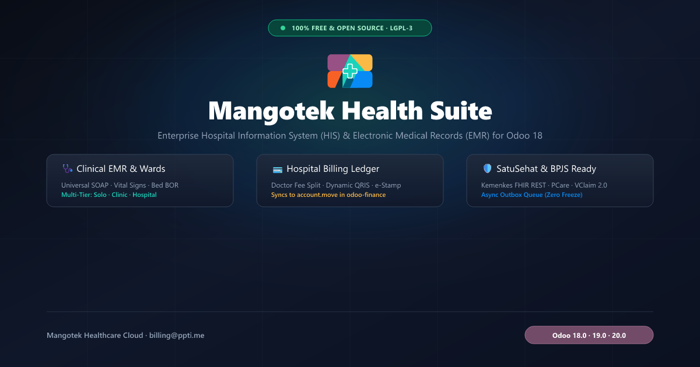
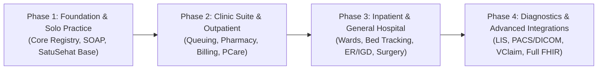

# Mangotek Health Suite

<p align="center">
  
</p>

<p align="center">
  <a href="LICENSE"></a>
  <a href="#"></a>
  <a href="#"></a>
  <a href="#"></a>
  <a href="#"></a>
</p>

---

## 🏥 Overview

**Mangotek Health Suite** is an enterprise-grade, modular Hospital Information System (HIS / SIMRS) and Electronic Medical Records (EMR) ecosystem engineered natively for **Odoo 18.0**. 

From **Solo Practitioner Clinics (TPMD)** and **Multi-Specialty Polyclinics** to **Full-Scale General Hospitals (Class C & D)**, Mangotek Health Suite streamlines clinical documentation, inpatient bed management, pharmaceutical logistics, and medical billing into a unified, secure platform.

---

## ✨ Key Features & Architecture

* **Multi-Tier Modular Deployment**: Activate only what your facility needs:
  - **Tier 1 (Solo Practice / GP)**: Fast registration, universal SOAP clinical notes, vital signs, SatuSehat baseline.
  - **Tier 2 (Clinics)**: Polyclinic queuing display, dental odontogram, maternal health (KIA), e-prescribing, cashier billing.
  - **Tier 3 (Hospitals)**: Inpatient wards & bed matrix (BOR tracking), 24/7 ER triage (ATS/ESI), operating theaters, LIS & PACS imaging.
* **Direct Financial Integration**: Natively connects with the [`odoo-finance`](../odoo-finance) ecosystem:
  - Dynamic QRIS cashier checkout via `account_qris_qbiz`.
  - Automated e-Stamp & digital medical document signatures via `account_stamp_signature`.
  - Automated doctor fee PPh 21 withholding tax via `l10n_id_coretax_taxation`.
  - Automated customer invoice posting & payment reconciliation via `account.move`.
* **National Compliance Built-in**:
  - **Kemenkes SatuSehat**: Asynchronous outbox pipeline for HL7 FHIR `Encounter`, `Condition`, `Observation`, `DiagnosticReport`, and `MedicationRequest`.
  - **BPJS Kesehatan**: Automated eligibility and claims bridging for PCare (FKTP) and VClaim 2.0 / Mobile JKN Online Queue (FKRTL).
* **API-First & Headless Clinician Workspace**: Ultra-responsive REST endpoints (`/api/v1/health/...`) powering single-page clinical dashboards and tablet-friendly charting.

---

## 🗺️ Implementation Roadmap & Phased Execution

Mangotek Health Suite is architected in four strategic, modular phases. Facilities can deploy iteratively based on their tier:



### [Phase 1] Core Foundation, Solo Practice (TPMD) & Regulatory Baseline ✅
- [x] **`health_base`**:
  - Master Patient Registry (`health.patient` with auto-generating MRN sequence & NIK validation).
  - Healthcare Practitioners (`health.physician` & `health.nurse` with SIP/STR & SatuSehat IHS mapping).
  - Departments & Polyclinics (`health.department`).
  - Standard Datasets: ICD-10 Diagnosis (`health.diagnosis`) & ICD-9 CM Procedure (`health.procedure`) seeds.
- [x] **`health_emr` (Universal Clinical SOAP)**:
  - Vital Signs Charting (`health.vital.sign`): BP, HR, RR, Temp, SpO2, and automated BMI compute.
  - Universal Clinical SOAP (`health.emr.soap`): Subjective, Objective, Assessment (ICD-10), and Plan.
  - Automated Medical Certificates: Sick leave, health clearance, and medical referral letters.
- [x] **`health_satusehat` (Kemenkes SatuSehat FHIR Gateway)**:
  - OAuth2 Client connector for Kemenkes SatuSehat Gateway (Sandbox & Production).
  - NIK & STR to SatuSehat IHS ID resolution service.
  - Asynchronous outbox pipeline for FHIR `Encounter` and `Condition` resources (`health.integration.log`).

---

### [Phase 2] Outpatient Clinics, Pharmacy & Financial Engine ✅
- [x] **`health_appointment`**:
  - Outpatient front-desk admission workflow for new and returning patients.
  - Daily clinic scheduling per physician with quota limits.
  - Sequential dynamic queue tickets (per Poli, Dokter, or Global) and Fullscreen TV digital queue display with Web Audio calling (`/health/queue/display`).
- [x] **`health_pharmacy`**:
  - Digital e-prescribing with Permenkes 73/2016 3-layer clinical review & Solo Practice fast-track mode.
  - Compounded medicines (Puyer / Kapsul / Salep) auto-decomposition into constituent active ingredients + Tuslah & Embalase fees.
  - Integration with Odoo WMS (`stock.picking`, `stock.lot` with FEFO expiration date tracking).
  - Automated dual-color prescription label printing (White for oral internal use, Blue for topical external use).
- [x] **`health_billing`**:
  - Centralized Patient Billing Ledger aggregating registration, consultations, procedures, and drugs.
  - Multi-tariff split model: Doctor Fee, Nurse Fee, Hospital Overhead, Consumables (BHP), Equipment.
  - Physician Remuneration Ledger (`health.physician.fee`) with automatic PPh 21 withholding deduction.
  - One-Click POS-Style settlement generating & reconciling customer invoices (`account.move`) with Dynamic QRIS receipt.
- [x] **`health_bpjs` (PCare Bridging FKTP)**:
  - BPJS PCare Web Service integration for primary care participant verification and outpatient encounter transmission.
  - Dual-mode: Real-time API dispatch with asynchronous outbox fallback (`health.integration.log`) and auto-retry cron.

---

### [Phase 3] Full-Scale Hospital Operations (Inpatient, Bed & ER) ⚡
- [x] **`health_inpatient`**:
  - Facility hierarchy: Buildings -> Wards / Pavilions (`health.ward`) -> Rooms & Beds (`health.bed`).
  - Room classifications (VVIP, VIP, Class 1, 2, 3, Isolation, ICU/ICCU/NICU).
  - Inpatient Stay Lifecycle (`health.inpatient.stay`): Bed reservation, admission, bed transfers, and pro-rated billing.
  - Real-time visual Bed Matrix dashboard with Bed Occupancy Rate (BOR) analytics.
  - Collaborative CPPT (Integrated Patient Progress Notes) for DPJP Doctors, Nurses, Pharmacists, and Dietitians with 24h verification SLA.
  - Electronic discharge summaries (Resume Medis KRS) with ICD-10 & ICD-9 CM coding.
- [x] **`health_emergency` (24/7 ER / IGD)**:
  - Emergency Triage classification (Red, Yellow, Green, Black) based on Australasian Triage Scale (ATS) / ESI criteria.
  - ABCD protocol clinical evaluation (Airway, Breathing, Circulation, Disability GCS, Exposure).
  - Fast-track anonymous 'Mr./Mrs. X' generator for trauma/comatose patients.
  - One-click seamless handover from ER stabilization directly into inpatient bed allocation.
- [ ] **`health_surgery` (Operating Room / OK & Delivery Room / VK)**:
  - Surgical booking schedule and theater calendar.
  - WHO Surgical Safety Checklist (Sign In, Time Out, Sign Out).
  - Pre-operative, intra-operative, and post-anesthesia recovery scoring (Aldrete / Bromage).
- [ ] **`health_hospital_pharmacy`**:
  - Multi-depot pharmacy management (Central Depot, Inpatient Depot, Outpatient Depot, ER Depot).
  - Automated stock replenishments and patient medication returns.

---

### [Phase 4] Diagnostic Support, Advanced Bridging & Hospital Analytics 🔬
- [x] **`health_laboratory` (Diagnostic Lab LIS)**:
  - Electronic lab order entry with age- and gender-specific reference boundaries.
  - Critical laboratory value (Panic Value) detection, red alert banner, and KARS/STARKES telephone readback logging.
  - Flexible specimen & phlebotomy tracking (2-step courier barcode vs 1-step direct mode).
  - Two-layer validation: Laboratory Analyst technical entry -> Clinical Pathologist (Sp.PK) clinical verification & QR code digital signature.
- [x] **`health_radiology` (Medical Imaging & PACS)**:
  - Radiology examination catalog across modalities: X-Ray, USG, CT-Scan, MRI, Mammografi, Fluoroskopi.
  - Hybrid DICOM PACS integration with Study Instance UID, Accession Number, and direct web viewer launch button (OHIF/Orthanc).
  - Radiographer exposure data (kVp, mAs, projection, contrast) & key image attachment.
  - Radiologist (Sp.Rad) structured expertise reporting (Findings, Impression, Recommendations) & QR code digital signature.
- [ ] **`health_bpjs_vclaim`**:
  - Automated SEP (Surat Eligibilitas Peserta) generation for Outpatient and Inpatient via VClaim 2.0.
  - SPRI (Surat Perintah Rawat Inap) and Outpatient Control Letter bridging.
  - Mobile JKN Online Queue synchronization.
- [ ] **`health_inacbg`**:
  - Medical claims tariff grouping data mapping (ICD-10 + ICD-9 CM).
  - Bridge to official national E-Klaim / INA-CBG grouper application.
- [ ] **`health_satusehat_full`**:
  - Comprehensive FHIR suite: `Observation`, `DiagnosticReport`, `MedicationRequest`, `MedicationDispense`, `AllergyIntolerance`, `Procedure`, and `EpisodeOfCare`.

---

## 🧩 Core Modular Packages

| Module Icon | Module Directory | Display Name | Target Facility Tier | Clinical / Operational Scope |
|:---:|:---|:---|:---:|:---|
|  | [`health_base`](health_base) | **Healthcare Base Master** | All Tiers (Solo, Clinic, Hospital) | • Master Patient Registry with auto-generating MRN (`ir.sequence`) & NIK validation<br>• Practitioner Directory (SIP/STR & SatuSehat IHS mapping)<br>• Official ICD-10 (14,000+ codes) & ICD-9 CM Procedure Seeds |
|  | [`health_emr`](health_emr) | **Clinical EMR Core** | All Tiers (Solo, Clinic, Hospital) | • Universal Clinical SOAP Notes with primary/secondary ICD-10 diagnostic tagging<br>• Multi-metric Vital Signs (BP, HR, RR, Temp, SpO2, and automated BMI compute)<br>• Automated Medical Certificates: Sick leaves, health clearance & referral letters |
|  | [`health_appointment`](health_appointment) | **Clinic Queuing Engine** | Clinics & Hospitals | • Outpatient admissions & daily physician consultation rosters<br>• Sequential queue ticket dispatch per polyclinic counter<br>• Waiting room TV digital queue display engine with live status feed |
|  | [`health_pharmacy`](health_pharmacy) | **Pharmacy & Dispensary** | Clinics & Hospitals | • Digital e-Prescribing with pharmacist administrative & clinical review<br>• Compounded medicine (puyer/capsules) auto-decomposition into active ingredients<br>• Native Odoo WMS integration (`stock.picking`, `stock.lot` with FEFO expiration tracking)<br>• Automated prescription label printing (White for oral, Blue for topical) |
|  | [`health_billing`](health_billing) | **Hospital Billing Ledger** | Clinics & Hospitals | • Centralized billing aggregator across registrations, consultations, procedures, and drugs<br>• Multi-component tariff decomposition (Doctor Fee, Nurse Fee, Hospital, BHP, KSO)<br>• Seamless sync with [`odoo-finance`](../odoo-finance): Dynamic QRIS, e-Stamp, PPh 21, and `account.move` |
|  | [`health_inpatient`](health_inpatient) | **Ward & Bed Management** | Inpatient Clinics & Hospitals | • Facility hierarchy: Buildings -> Wards / Pavilions -> Rooms -> Beds (VVIP, VIP, Class 1-3, ICU)<br>• Real-time visual Bed Matrix & Bed Occupancy Rate (BOR) analytics<br>• Inter-ward bed transfers with automated pro-rated tariff adjustments<br>• Collaborative CPPT progress notes & electronic discharge summaries |
|  | [`health_emergency`](health_emergency) | **Emergency Room Triage** | Hospitals | • 24/7 Emergency Department (IGD) triage (Red, Yellow, Green, Black) per ATS / ESI<br>• Emergency fast-track admission bypassing upfront registration queues<br>• Immediate resuscitation tracking & ward transfer handoffs |
|  | [`health_laboratory`](health_laboratory) | **Diagnostic Lab LIS** | Diagnostic Clinics & Hospitals | • Electronic lab test order entry from outpatient, inpatient, or ER<br>• Standard reference intervals mapped to patient age and gender<br>• Laboratory Information System (LIS) bridging for hematology & chemistry analyzers<br>• Critical value emergency alert broadcasts |
|  | [`health_radiology`](health_radiology) | **Medical Imaging PACS** | Diagnostic Clinics & Hospitals | • Imaging examination orders (X-Ray, Ultrasound, CT Scan, MRI)<br>• Structured radiologist expertise reports with normal finding templates<br>• PACS connector with embedded web-based DICOM medical image viewer |
|  | [`health_satusehat`](health_satusehat) | **Kemenkes SatuSehat FHIR** | All Tiers | • National health cloud OAuth2 connector (Sandbox & Production)<br>• Automated patient & practitioner SatuSehat IHS ID resolution<br>• Resilient asynchronous outbox queue for FHIR `Encounter`, `Condition`, `Observation`, and `MedicationRequest` |
|  | [`health_bpjs`](health_bpjs) | **BPJS Healthcare Bridge** | Clinics & Hospitals | • BPJS PCare Web Service integration for primary care facilities (FKTP)<br>• BPJS VClaim 2.0 SEP generation, SPRI & Online Referral for hospitals (FKRTL)<br>• Mobile JKN Online Queue check-in synchronization |

---

## 🚀 Quickstart via Docker

To run Mangotek Health Suite locally with the provided Docker container setup:

```bash
# 1. Clone into your Odoo workspace
cd c:\Users\Lenovo\Documents\odoo

# 2. Start Odoo 18 & PostgreSQL containers
docker compose up -d

# 3. Access Odoo Web Client in browser
# URL: http://localhost:8069
```

---

## 📚 Documentation & Governance

- 🗺️ **[ROADMAP.md](ROADMAP.md)**: Master 4-phase project roadmap and implementation checklist.
- 🎨 **[BRANDKIT.md](BRANDKIT.md)**: Visual identity, color tokens, iconography standards, and banner specifications.
- 🤖 **[AGENTS.md](AGENTS.md)**: Mandatory rules for AI coding agents (anti-slop, comment hygiene, security standards).
- 🏪 **[PUBLISHING.md](PUBLISHING.md)**: Odoo Apps Store submission standards to achieve a 5.0 / 5.0 quality rating.
- 🔒 **[SECURITY.md](SECURITY.md)**: Protected Health Information (PHI) security, RBAC, and vulnerability disclosure policy.
- 🤝 **[CONTRIBUTING.md](CONTRIBUTING.md)**: Contribution guidelines and code conventions.
- 📜 **[LICENSE](LICENSE)**: GNU Lesser General Public License version 3 (LGPL-3.0).

---

## ⚖️ License & Community

Mangotek Health Suite is open-source software licensed under the **[LGPL-3.0](LICENSE)**. Maintained by Mangotek Healthcare Cloud and contributors.
