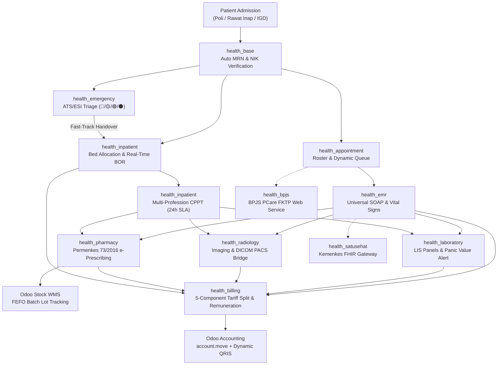
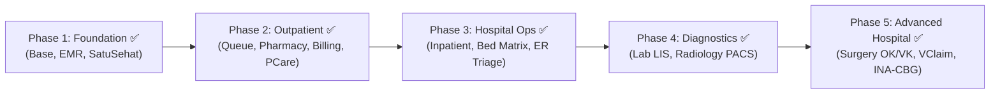

<div align="center">


# MangoTek Health Suite

[](LICENSE)
[](#)
[](https://www.odoo.com/)
[](https://github.com/Mango-Teknusa-Inovasi/odoo-health-suite/actions/workflows/ci.yml)
[](#)
[](#)
[](#)
[](https://github.com/Mango-Teknusa-Inovasi)

**Enterprise Hospital Information System (SIMRS), Electronic Medical Records (EMR / RME), SatuSehat FHIR, BPJS Bridge, LIS & PACS for Odoo 18.0, 19.0 & 20.0.**

[Overview](#-overview) • [Core Modules](#-core-modules) • [Clinical Architecture](#-clinical-architecture--data-flow) • [Roadmap](#-multi-phase-engineering-roadmap) • [Installation](#-getting-started) • [Repository Layout](#-repository-layout) • [License](#-license)

</div>

---

## 🌟 Overview

Operating a modern medical facility—from solo medical practices (TPMD) and primary healthcare centers (FKTP/Klinik Pratama) to Class C/D General Hospitals—requires strict adherence to Indonesian clinical governance, national health data bridging mandates, and high-stakes patient safety protocols.

**MangoTek Health Suite** delivers an enterprise-grade, modular, and open-source Hospital Information System (SIMRS) designed natively for Odoo. Built to fulfill **Permenkes No. 24/2022** regarding Mandatory Electronic Medical Records (RME), national interoperability with **Kemenkes SatuSehat (HL7 FHIR)**, and statutory **BPJS Kesehatan (PCare & VClaim)** bridging.

> [!NOTE]
> **100% Free & Open Source:** This entire healthcare suite is published under the **GNU Lesser General Public License v3.0 (LGPL-3.0)**. It is free to use, deploy, and customize on both **Odoo Community** and **Odoo Enterprise** without licensing fees, seat restrictions, or proprietary lock-ins.

---

## 🧩 Core Modules

| Module Icon | Module Directory | Display Name | Statutory & Clinical Scope |
|:---:|:---|:---|:---|
|  | [`health_base`](health_base) | **Healthcare Base Master** | • Master Patient Registry (`health.patient`) with automated sequential MRN & 16-Digit NIK validation<br>• Practitioner credentials (`health.physician`, `health.nurse`) with SIP/STR & SatuSehat IHS mapping<br>• Polyclinics, inpatient departments (`health.department`), and seed catalogs for ICD-10 & ICD-9 CM |
|  | [`health_emr`](health_emr) | **Clinical EMR Core** | • Universal SOAP clinical documentation (Subjective, Objective, Assessment, Plan)<br>• Tanda-Tanda Vital (TTV) tracking: BP, HR, RR, Temp, SpO2, and automated Body Mass Index (BMI)<br>• Automated digital medical certificates: Sick leave, health clearance, and clinical referrals |
|  | [`health_appointment`](health_appointment) | **Clinic Queuing Engine** | • Polyclinic scheduling & doctor practice rosters (`health.physician.schedule`) with quota limits<br>• Sequential dynamic queue ticketing (by Polyclinic, by Doctor, or Global)<br>• Fullscreen TV digital queue screen (`/health/queue/display`) with Web Audio Indonesian speech calling |
|  | [`health_pharmacy`](health_pharmacy) | **Pharmacy & Dispensary** | • e-Prescribing with Permenkes 73/2016 3-layer audit (Administrative, Pharmaceutical, Clinical)<br>• Compounded medicine decomposition (Puyer / Kapsul / Salep) with Tuslah & Embalase fees<br>• Odoo WMS integration (`stock.picking`, `stock.lot` with FEFO expiration tracking) & dual-color label printing |
|  | [`health_billing`](health_billing) | **Hospital Billing Ledger** | • Centralized Patient Billing Ledger consolidating registration, procedures, lab, and medications<br>• 5-component medical tariff split: Doctor Fee, Nurse Fee, Hospital Overhead, Consumables (BHP), Equipment<br>• Doctor Remuneration Ledger with Indonesian PPh 21 withholding deduction & 1-click POS invoice posting |
|  | [`health_inpatient`](health_inpatient) | **Ward & Bed Management** | • Facility hierarchy: Buildings -> Wards / Pavilions (`health.ward`) -> Rooms & Beds (`health.bed`)<br>• Real-time visual Bed Matrix kanban dashboard with Bed Occupancy Rate (BOR %) analytics<br>• Bed sanitation sterilization workflow (`cleaning` -> `available`) & inter-ward mutation transfers<br>• Multi-profession CPPT notes (DPJP, Nurse, Pharmacist, Dietitian) with 24h verification SLA & KRS discharge summary |
|  | [`health_emergency`](health_emergency) | **Emergency Room Triage** | • Australasian Triage Scale (ATS) / ESI color-coded triage: 🔴 Red, 🟡 Yellow, 🟢 Green, ⚫ Black<br>• Rapid ABCD clinical evaluation (Airway, Breathing, Circulation, Disability GCS 3-15, Exposure)<br>• Fast-track anonymous 'Mr./Mrs. X' generator for unidentified trauma patients<br>• 1-click direct handover into Inpatient ICU / ward beds bypassing administrative bottlenecks |
|  | [`health_laboratory`](health_laboratory) | **Diagnostic Lab LIS** | • Lab test panels (Darah Lengkap CBC, Glukosa, Fungsi Ginjal, Profil Lipid) with LOINC coding<br>• Stratified reference ranges by patient age & gender with automated Panic Value (Nilai Kritis) alerting<br>• KARS/STARKES telephone read-back call logging & flexible specimen phlebotomy tracking<br>• 2-layer specialist validation: Lab Analyst entry -> Clinical Pathologist (Sp.PK) QR digital signature |
|  | [`health_radiology`](health_radiology) | **Medical Imaging PACS** | • Radiology catalog across modalities: X-Ray (CR/DR), USG, CT-Scan, MRI, Mammografi, Fluoroskopi<br>• Hybrid DICOM PACS bridge: Study Instance UID, Accession Number, and direct web viewer launch button<br>• Radiographer technical data (kVp, mAs, projection, contrast) & key image findings attachment<br>• Radiologist (Sp.Rad) structured expertise reporting (Findings, Impression, Suggestions) with QR signature |
|  | [`health_satusehat`](health_satusehat) | **Kemenkes SatuSehat FHIR** | • OAuth2 Client connector for official Kemenkes SatuSehat Gateway (Sandbox & Production)<br>• Automated patient NIK & doctor STR resolution to SatuSehat IHS Numbers<br>• Asynchronous Outbox queue for HL7 FHIR `Encounter` and `Condition` resources with auto-retry cron |
|  | [`health_bpjs`](health_bpjs) | **BPJS Healthcare Bridge** | • BPJS PCare FKTP Web Service connector for participant verification and diagnosis transmission<br>• Secure HMAC-SHA256 timestamped authentication header engine<br>• Outpatient encounter bridging with dual-mode real-time dispatch and outbox fallback queue |
|  | [`health_surgery`](health_surgery) | **Operating Room & VK** | • Multidisciplinary surgical theater scheduling (Elective vs Cito) & room status matrix<br>• WHO Surgical Safety Checklist (Sign In, Time Out, Sign Out) with DPJP digital verification<br>• Post-Anesthesia Recovery Scoring (Aldrete >= 8, Bromage <= 1, Steward >= 5) for safe PACU discharge<br>• Delivery Suite (VK) partograph tracking (Kala I-IV), neonate APGAR scoring, and IMD |
|  | [`health_bpjs_vclaim`](health_bpjs_vclaim) | **BPJS Hospital VClaim** | • Automated Inpatient & Outpatient SEP (Surat Eligibilitas Peserta) generation via VClaim 2.0<br>• Electronic SPRI (Surat Perintah Rawat Inap) and outpatient control letter bridging<br>• Official continuous landscape Cetak Lembar SEP PDF report with barcodes & consent clause |
|  | [`health_inacbg`](health_inacbg) | **INA-CBG E-Klaim Grouper** | • Kemenkes Case-Mix grouper for diagnostic ICD-10 & surgical ICD-9 CM procedures<br>• Special CMG add-on top-up tariff calculation (implants, stents, chemotherapy)<br>• Automated Cost Disparity Audit comparing Hospital Real Bill vs INA-CBG Tariff (Surplus vs Deficit) |

---

## 🏥 Clinical Architecture & Data Flow



---

## 🚀 Multi-Phase Engineering Roadmap



### [Phase 1] Core Foundation, Solo Practice (TPMD) & Regulatory Baseline ✅
- [x] **`health_base`**: Master Patient Registry with auto-generating MRN sequence, practitioners (SIP/STR), departments, and ICD-10 / ICD-9 CM seeds.
- [x] **`health_emr`**: Vital signs charting (auto BMI), universal clinical SOAP, and automated medical certificates (Sick leave, referral).
- [x] **`health_satusehat`**: OAuth2 SatuSehat Gateway connector, IHS resolution service, and asynchronous outbox for FHIR `Encounter` and `Condition`.

### [Phase 2] Outpatient Clinics, Pharmacy & Financial Engine ✅
- [x] **`health_appointment`**: Doctor roster scheduling with quota limits, dynamic queue tickets, and fullscreen TV queue display with speech synthesis.
- [x] **`health_pharmacy`**: e-Prescribing with Permenkes 73/2016 3-layer review, active ingredient compounding decomposition, stock picking FEFO, and dual-color labels.
- [x] **`health_billing`**: 5-component medical tariff split, Doctor Remuneration Ledger with Indonesian PPh 21 withholding deduction, and 1-click POS invoice settlement.
- [x] **`health_bpjs`**: BPJS PCare FKTP Web Service integration with HMAC-SHA256 signature and auto-retry cron queue.

### [Phase 3] Full-Scale Hospital Operations (Inpatient, Bed & ER) ✅
- [x] **`health_inpatient`**: Facility hierarchy (`health.ward`, `health.bed`), Real-time Bed Matrix dashboard with BOR analytics, bed sanitation lifecycle (`cleaning` -> `available`), inter-ward transfers with pro-rated tariffs, multi-profession CPPT notes with 24h DPJP verification, and KRS electronic discharge summary.
- [x] **`health_emergency`**: Australasian Triage Scale (ATS) / ESI triage (Red, Yellow, Green, Black), ABCD protocol assessment, fast-track anonymous 'Mr./Mrs. X' generator, and 1-click emergency inpatient handover.

### [Phase 4] Diagnostic Support, Clinical Investigations (LIS & PACS) ✅
- [x] **`health_laboratory`**: Test panels (CBC, Glucose, Renal, Lipid) with LOINC mapping, age/gender stratified reference ranges, automated Panic Value detection with emergency red alert banner, KARS telephone readback log, and Sp.PK specialist verification.
- [x] **`health_radiology`**: Modality catalog (X-Ray, USG, CT, MRI, Mammografi), hybrid DICOM PACS bridge with Study UID / Accession Number, direct PACS web viewer launcher button, radiographer exposure metrics, and Sp.Rad structured expertise reporting.

### [Phase 5] Advanced Hospital Operations & National Insurance Claims ✅
- [x] **`health_surgery`**: Multidisciplinary surgical theater scheduling, WHO Surgical Safety Checklist (Sign In, Time Out, Sign Out), post-anesthesia recovery scoring (Aldrete, Bromage, Steward), and delivery suite (VK) partograph tracking.
- [x] **`health_bpjs_vclaim`**: Automated Inpatient & Outpatient SEP (Surat Eligibilitas Peserta) generation via VClaim 2.0, SPRI bridging, Surat Kontrol Poliklinik, and official Cetak SEP PDF report.
- [x] **`health_inacbg`**: Ministry of Health (Kemenkes) INA-CBG Case-Mix Grouper bridging, ICD-10 & ICD-9 CM diagnostic grouping, Special CMG add-ons, and automated Hospital Real Cost Disparity Audit.

---

## 📂 Repository Layout

```text
odoo-health-suite/
├── assets/
│   ├── banner_master.png            # High-resolution 1200x630 repo hero banner
│   ├── banner_master.svg            # Vector source banner
│   ├── social_preview.png           # 1280x640 OpenGraph social preview card
│   └── icons/                       # SVG and PNG renders (50px, 100px, 512px, 1024px)
├── health_base/                     # Master patient registry, medical staff & catalogs
├── health_emr/                      # Universal clinical SOAP notes & vital signs
├── health_appointment/              # Polyclinic queue tickets & TV digital screen
├── health_pharmacy/                 # e-Prescription, compounding & FEFO dispensary
├── health_billing/                  # 5-component tariff split & doctor remuneration ledger
├── health_inpatient/                # Ward & bed matrix, BOR analytics, CPPT & discharge summary
├── health_emergency/                # 24/7 ER triage (ATS/ESI), ABCD assessment & Mr. X fast-track
├── health_laboratory/               # Diagnostic LIS, age/gender normal ranges & panic values
├── health_radiology/                # Medical imaging, hybrid DICOM PACS bridge & Sp.Rad expertise
├── health_satusehat/                # Kemenkes SatuSehat HL7 FHIR gateway connector
├── health_bpjs/                     # BPJS PCare FKTP web service bridge
├── health_surgery/                  # Operating theater (IBS), WHO checklist, PACU & VK delivery
├── health_bpjs_vclaim/              # BPJS Hospital VClaim 2.0 SEP generator & SPRI
├── health_inacbg/                   # Kemenkes INA-CBG E-Klaim grouper & disparity audit
├── tests/                           # Master automated unit & E2E clinical test suites (37 tests)
├── scripts/                         # Apps Store compliance validator (112/112 checks)
├── AGENTS.md                        # Multi-version branching & zero-conflict protocol
├── CONTRIBUTING.md                   # Development standards & guidelines
└── README.md                        # Master documentation
```

---

## 🚀 Getting Started

### Prerequisites
* **Odoo:** Version `18.0`, `19.0`, or `20.0` (Community or Enterprise)
* **Python:** `3.10` or higher
* **Database:** PostgreSQL `14+`
* **Dependencies:** `base`, `mail`, `stock`, `account`

### Installation

1. **Clone this repository** into your custom addons directory:
   ```bash
   git clone https://github.com/Mango-Teknusa-Inovasi/odoo-health-suite.git
   ```

2. **Add to your Odoo configuration file (`odoo.conf`)**:
   ```ini
   addons_path = /usr/lib/python3/dist-packages/odoo/addons,/mnt/custom-addons/odoo-health-suite
   ```

3. **Update Odoo apps database**:
   ```bash
   python3 odoo-bin -c /etc/odoo/odoo.conf -d your_database -u health_base --stop-after-init
   ```

4. **Activate in Odoo Web Client**:
   * Open **Settings** > Activate **Developer Mode**.
   * Navigate to the **Apps** menu.
   * Click **Update Apps List** in the top navigation bar.
   * Search for `Healthcare Base Master`, `Ward & Bed Management`, `Diagnostic Lab LIS`, etc., and click **Activate**.

---

## 👥 Authors & Maintainers

* **Mango Teknusa Inovasi** ([@Mango-Teknusa-Inovasi](https://github.com/Mango-Teknusa-Inovasi))
* **Maintainer:** `ardianryan` ([@ardianryan](https://github.com/ardianryan))
* **Support & Desk:** `ardianr94@gmail.com` • `billing@ppti.me`

---

## 📄 License

This software suite is published under the **GNU Lesser General Public License v3.0 (LGPL-3.0)**.  
See the full text in [LICENSE](LICENSE).
