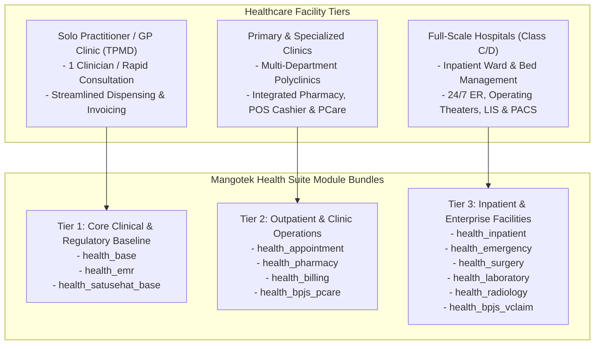
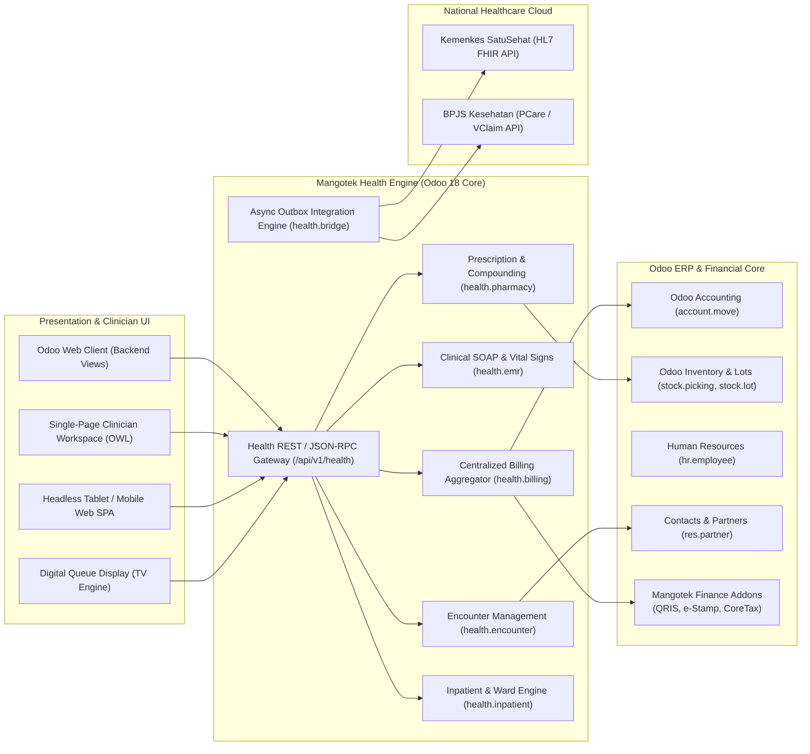
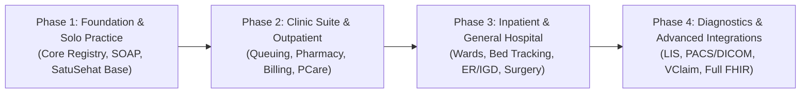
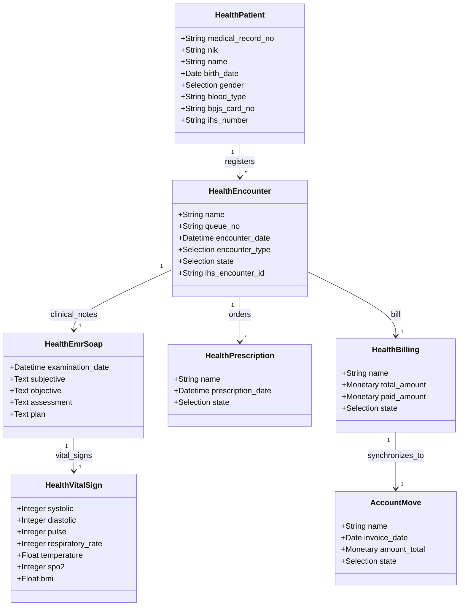

# Mangotek Health Suite
## Enterprise Hospital Information System (HIS) & Electronic Medical Records (EMR) for Odoo 18

---

## 1. Executive Summary & Vision

**Mangotek Health Suite** is an enterprise-grade, modular Healthcare Management System and Hospital Information System (HIS / SIMRS) natively architected for **Odoo 18.0**. 

Designed to scale seamlessly across healthcare tiers—from **Solo Practitioner Clinics (TPMD)** and **Multi-Specialty Primary Clinics** to **Full-Scale General Hospitals (Class C & D)**—it unifies clinical administration, Electronic Medical Records (EMR), point-of-care diagnostics, pharmaceutical supply chains, and hospital financial accounting into a single, cohesive ecosystem.

### Core Architectural Pillars
- **Multi-Tier Scalability**: Activate only the modules required for your healthcare tier, avoiding bloated workflows for small clinics while delivering enterprise capabilities for multi-bed hospitals.
- **Deep Financial & ERP Integration**: Natively connected with financial ledgers, automated general practitioner/specialist medical fee split, automated inventory valuation (AVCO/FIFO with FEFO lot expiration), and digital payment gateways (Dynamic QRIS, e-Stamp, automated tax withholding).
- **National Regulatory Compliance**: Built-in compatibility with **Indonesian Ministry of Health (Kemenkes) SatuSehat** (HL7 FHIR RESTful standards) and **BPJS Kesehatan** (PCare for primary care, VClaim & Mobile JKN online queuing for hospitals).
- **API-First & Headless Clinician Workspace**: Provides a high-efficiency Single-Page Clinician Workspace (SPA/Tablet friendly) via dedicated REST APIs (`/api/v1/health/...`), ensuring zero-latency clinical charting during patient examinations.

---

## 2. Multi-Tier Healthcare Matrix



### Comparative Capabilities Across Tiers

| Domain | Solo Practitioner (TPMD) | Primary / Specialty Clinic | General Hospital (Class C / D) |
| :--- | :--- | :--- | :--- |
| **Patient Registration** | Rapid single-counter check-in, search by National ID (NIK) or Medical Record No. | Front-desk admission desk, polyclinic queue tickets, automated queue calling displays. | Multi-channel admission (Outpatient, Inpatient, Emergency), online booking, Mobile JKN queue sync, automated SEP BPJS eligibility. |
| **Clinical Charting (EMR)** | Universal SOAP notes, vital signs tracking, automated medical certificates & sick leaves. | Specialty-tailored templates: Odontogram (Dental), Maternal & Child Health (MCH/ANC), screening forms. | Integrated Clinical Pathway (CPPT) shared across Doctors, Nurses, and Clinical Pharmacists; emergency triage (ATS/ESI), operative reports. |
| **Pharmacy & Medication** | Internal clinic medicine cabinet inventory, basic e-prescriptions. | Full e-prescribing, clinical recipe review, prescription label printing (internal/external use), batch/expiry FEFO tracking. | Multi-depot pharmacy management (Central Warehouse, Outpatient Depot, Inpatient Depot, Emergency Depot), compounded medicines (puyer/capsules) auto-decomposition, take-home medication. |
| **Inpatient & Facilities** | *Not applicable* | Short-stay observation beds (for inpatient-licensed clinics). | Ward, room, and bed master management; real-time Bed Occupancy Rate (BOR); bed transfers; daily nursing fluid balance charts; discharge summaries. |
| **Diagnostics & Penunjang** | Point-of-care rapid testing (blood glucose, cholesterol, uric acid). | Standard hematology and urine tests with predefined normal reference ranges. | Automated Laboratory Information System (LIS) analyzer bridging; Picture Archiving and Communication System (PACS) DICOM imaging viewer integration. |
| **Billing & Finance** | Combined consultation + medication receipt at front desk. | Centralized billing counter, automated doctor fee commission breakdown, dynamic QRIS instant payment. | Multi-component tariff splitting (Doctor Fee, Nursing Fee, Hospital Overhead, Consumables/BHP, Equipment KSO), deposit management, insurance receivables reconciliation. |
| **Regulatory Bridging** | Kemenkes SatuSehat baseline (`Encounter`, `Condition`). | Kemenkes SatuSehat + BPJS PCare FKTP. | Full Kemenkes SatuSehat suite + BPJS VClaim (SEP, SPRI, Referral), INA-CBG grouper support. |

---

## 3. High-Level Architecture & Design Principles



### Key Engineering Paradigms
1. **Polymorphic Encounter Model**: Rather than maintaining separate, duplicated schemas for outpatient and inpatient registrations, a single `health.encounter` model tracks the entire patient journey through customizable operational states.
2. **Centralized Billing Aggregator with Instant ERP Sync**: Clinical and pharmaceutical charges are collected dynamically under `health.billing.line`. Upon cashier settlement, the engine synthesizes an `account.move` customer invoice and payment reconciliation instantly in the background.
3. **True FEFO Inventory with Compounding Decomposition**: Compounded medicines (pulveres, syrups, capsules) automatically compute ingredient dosage and deduct respective batch/lot numbers from the assigned pharmacy depot stock upon verification.
4. **Resilient Asynchronous Outbox Queue**: External communications with national servers (SatuSehat, BPJS) never block user interactions. Payloads are persisted to an outbox queue (`health.integration.log`) and dispatched via background cron workers with automated retry and audit logging.

---

## 4. Master Project Roadmap & Detailed Todo List



---

### Phase 1: Foundation, Solo Practice & Regulatory Baseline
*Focus: Establish the master domain models, patient identity registry, universal clinical consultation workspace, and basic national health cloud compliance.*

- [ ] **Package: `health_base` (Master Directory & Standards)**
  - [ ] Implement `health.patient` (inherited from `res.partner`):
    - [ ] Auto-generating Medical Record Number (MRN) via configurable `ir.sequence`.
    - [ ] National Identity Number (NIK) field with format validation.
    - [ ] Family relation linking (parent, spouse, emergency contacts).
    - [ ] Chronic allergies, blood type, and demographic classification.
  - [ ] Implement `health.physician` & `health.nurse`:
    - [ ] Practice License Number (SIP) and Medical Registration Certificate (STR) tracking.
    - [ ] Specialty categories (`health.specialty`).
    - [ ] Practitioner SatuSehat IHS ID mapping.
    - [ ] Linkage to `hr.employee` and `res.partner`.
  - [ ] Implement `health.department` (Polyclinics, Service Units, Administrative Units).
  - [ ] Standard Medical Coding Seed Datasets:
    - [ ] Complete ICD-10 Diagnosis Catalogue (`health.diagnosis`).
    - [ ] Complete ICD-9 CM Procedure Catalogue (`health.procedure`).
- [ ] **Package: `health_emr` (Universal Clinical Documentation)**
  - [ ] Implement `health.vital.sign`:
    - [ ] Systolic & Diastolic Blood Pressure (mmHg).
    - [ ] Heart Rate / Pulse (bpm) & Respiratory Rate (breaths/min).
    - [ ] Body Temperature (°C) & Oxygen Saturation (SpO2 %).
    - [ ] Height (cm), Weight (kg), and automated BMI + Nutritional Classification compute.
    - [ ] Glasgow Coma Scale (GCS) and Consciousness Level selector.
  - [ ] Implement `health.emr.soap`:
    - [ ] Subjective (chief complaint, present illness history).
    - [ ] Objective (physical examination findings + vital signs link).
    - [ ] Assessment (multi-select ICD-10 diagnosis tagging: Primary vs Secondary).
    - [ ] Plan (medical intervention, treatment strategy, follow-up scheduling).
  - [ ] Clinical Document Generators:
    - [ ] Medical Sick Leave Certificate (`report_sick_leave`).
    - [ ] Physical Health Certificate (`report_health_clearance`).
    - [ ] Medical Referral Letter (`report_referral`).
- [ ] **Package: `health_api_base` (Headless Clinician Gateway)**
  - [ ] JWT / Session-based authentication endpoints for clinical practitioners.
  - [ ] REST API routes for patient lookup, queue fetching, and SOAP submission.
- [ ] **Package: `health_satusehat_base` (Phase 1 Compliance)**
  - [ ] OAuth2 Client Connector for Kemenkes SatuSehat Gateway (Sandbox & Production environments).
  - [ ] Patient National ID (NIK) to SatuSehat IHS ID resolution service.
  - [ ] Practitioner STR/NIK to SatuSehat IHS ID resolution service.
  - [ ] Async Outbox pipeline for FHIR `Encounter` and `Condition` resources.

---

### Phase 2: Outpatient Clinics, Pharmacy & Financial Engine
*Focus: Expand into multi-department outpatient clinics, integrated dispensary operations, cashier billing, and primary care insurance.*

- [ ] **Package: `health_appointment` (Admission & Queue Orchestration)**
  - [ ] Front-desk outpatient admission workflow for new and returning patients.
  - [ ] Daily clinic scheduling per physician with quota limits.
  - [ ] Sequential queue ticket allocation per polyclinic counter.
  - [ ] Digital Queue Display engine (JSON web feed for waiting room TV monitors).
- [ ] **Package: `health_emr_specialty` (Specialized Clinical Charting)**
  - [ ] Dental Polyclinic Module:
    - [ ] Interactive Odontogram matrix (Adult & Deciduous tooth map).
    - [ ] Tooth condition indicators (Caries, Missing, Filled, Crown, Extraction required).
  - [ ] Maternal & Child Health (MCH / KIA) Module:
    - [ ] Antenatal Care (ANC) examination tracker & obstetric history.
    - [ ] Pediatric immunization schedule & developmental milestone records.
- [ ] **Package: `health_pharmacy` (e-Prescribing & Dispensary Management)**
  - [ ] Master Drug Catalogue enhancements (`product.template`):
    - [ ] Dosage forms (tablet, syrup, injection, ointment, capsule).
    - [ ] Active pharmaceutical ingredients (API) and standard packaging units.
    - [ ] KFA (Kamus Farmasi Alkes) code mapping for SatuSehat sync.
  - [ ] Digital Prescription Workflow (`health.prescription`):
    - [ ] Standard prescription lines (drug, quantity, instruction/signa).
    - [ ] Compounded medicine engine (custom formula, constituent active ingredients, total pack count, compounding fee).
    - [ ] Pharmacist prescription screening (administrative, pharmaceutical, and clinical review checks).
  - [ ] Dispensing & WMS Integration:
    - [ ] Automated generation of internal `stock.picking` from dispensary depot.
    - [ ] First-Expired-First-Out (FEFO) lot/batch selection (`stock.lot`).
    - [ ] Automated prescription label printing (White label for internal oral use, Blue label for external topical use).
- [ ] **Package: `health_billing` (Cashier & Revenue Management)**
  - [ ] Centralized Patient Billing Ledger (`health.billing`):
    - [ ] Aggregates registration fees, physician consultation fees, clinical procedures, nursing care, and dispensed drugs.
    - [ ] Multi-tariff decomposition model (`health.service.tariff`): Doctor Share, Nurse Share, Facility Overhead, Medical Supplies (BHP), Equipment Share.
  - [ ] Integration with Financial Ecosystem (`odoo-finance`):
    - [ ] Direct posting of settled billing into Odoo `account.move` (Customer Invoice & Receipt).
    - [ ] Instant payment via Dynamic QRIS powered by `account_qris_qbiz`.
    - [ ] Automated official stamp and doctor digital signature powered by `account_stamp_signature`.
    - [ ] Automated Article 21 (PPh 21) withholding tax calculation on doctor fee portions linked to `l10n_id_coretax_taxation`.
- [ ] **Package: `health_bpjs_pcare` (Primary Care Health Insurance)**
  - [ ] Verification of BPJS participant eligibility via PCare Web Service.
  - [ ] Transmission of primary care encounter data, clinical diagnoses, and prescriptions.

---

### Phase 3: Full-Scale Hospital Operations (Inpatient, Bed & ER)
*Focus: Deliver comprehensive enterprise hospital workflows, including 24/7 Emergency Care, Wards, Operating Theaters, and Inpatient Clinical Pathways.*

- [ ] **Package: `health_inpatient` (Ward, Room & Bed Management)**
  - [ ] Hospital Facility Hierarchy: Buildings -> Wards / Pavilions -> Rooms -> Beds.
  - [ ] Room Classifications (VVIP, VIP, Class 1, Class 2, Class 3, Isolation, ICU/ICCU/NICU).
  - [ ] Inpatient Stay Lifecycle (`health.inpatient.stay`):
    - [ ] Bed reservation and inpatient admission from Outpatient or Emergency Dept.
    - [ ] Bed transfer (mutation) across rooms and classes with automatic pro-rated tariff adjustments.
    - [ ] Real-time visual Bed Matrix dashboard displaying occupied, vacant, cleaning, and maintenance states.
    - [ ] Hospital Bed Occupancy Rate (BOR), Average Length of Stay (AvLOS), and Bed Turnover Interval (BTO) analytics.
  - [ ] Inpatient Clinical Charting (CPPT - Integrated Patient Progress Notes):
    - [ ] Multi-disciplinary collaborative SOAP logging (Attending Physicians, Duty Doctors, Ward Nurses, Dietitians, Clinical Pharmacists).
    - [ ] Vital signs multi-point daily chart (temperature curves, blood pressure trends).
    - [ ] Nursing fluid balance monitoring sheet (intake vs output).
    - [ ] Electronic Inpatient Discharge Summary (`report_discharge_summary`).
- [ ] **Package: `health_emergency` (Emergency Department / IGD 24/7)**
  - [ ] Emergency Triage Classification (Red - Resuscitation, Yellow - Emergent, Green - Non-urgent, Black - Deceased) based on ATS / ESI criteria.
  - [ ] Emergency fast-track admission (instant registration bypass for immediate stabilization).
  - [ ] Triage to Ward, Operating Room, or Outpatient transfer tracking.
- [ ] **Package: `health_surgery` (Operating Room / OK & Delivery Room / VK)**
  - [ ] Surgical booking schedule and theater calendar.
  - [ ] WHO Surgical Safety Checklist (Sign In, Time Out, Sign Out).
  - [ ] Pre-operative, intra-operative, and post-anesthesia recovery scoring (Aldrete / Bromage score).
  - [ ] Operative and anesthesia report builder.
- [ ] **Package: `health_hospital_pharmacy` (Multi-Depot Pharmacy Logistics)**
  - [ ] Dedicated physical/virtual depot locations (Emergency Depot, Central Depot, Inpatient Depot, Outpatient Depot).
  - [ ] Automated internal stock transfers between depots based on minimum reorder levels.
  - [ ] Return medication handling (unopened medications returned upon patient discharge).

---

### Phase 4: Penunjang Medis, Advanced Bridging & Hospital Analytics
*Focus: Diagnostic laboratories, medical imaging, hospital insurance claims, and full-spectrum national data exchanges.*

- [ ] **Package: `health_laboratory` (Diagnostic Laboratory & LIS)**
  - [ ] Electronic lab order entry directly from Outpatient, Inpatient, or Emergency departments.
  - [ ] Laboratory test catalog with age- and gender-specific standard reference intervals.
  - [ ] Specimen collection and barcode tracking.
  - [ ] Laboratory Information System (LIS) bridging connector for automated results import from hematology and clinical chemistry analyzers.
  - [ ] Critical value alert notifications sent directly to attending physicians.
- [ ] **Package: `health_radiology` (Medical Imaging & PACS)**
  - [ ] Radiology examination orders (X-Ray, Ultrasound, CT Scan, MRI).
  - [ ] Radiologist expert opinion report builder with predefined normal templates.
  - [ ] Picture Archiving and Communication System (PACS) connector with web-based DICOM image viewer integration.
- [ ] **Package: `health_bpjs_vclaim` (Hospital Insurance & Claims Engine)**
  - [ ] Automated SEP (Surat Eligibilitas Peserta) issuance for Outpatient and Inpatient admissions via VClaim 2.0 Web Service.
  - [ ] SPRI (Surat Perintah Rawat Inap) & Outpatient Control Letter bridging.
  - [ ] Online Referral integration (Sistem Rujukan Terintegrasi).
  - [ ] Mobile JKN Online Queue synchronization (check-in validation, queue status callbacks).
- [ ] **Package: `health_inacbg` (National Casemix Grouper Support)**
  - [ ] Medical claims tariff grouping data mapping (ICD-10 primary/secondary diagnoses + ICD-9 CM surgical procedures).
  - [ ] Data exchange bridge to official E-Klaim / INA-CBG grouper application.
- [ ] **Package: `health_satusehat_full` (Comprehensive FHIR Ecosystem)**
  - [ ] Diagnostic Services: FHIR `DiagnosticReport` (Lab & Radiology) and `Observation`.
  - [ ] Medication Ecosystem: FHIR `MedicationRequest` and `MedicationDispense`.
  - [ ] Clinical Safety: FHIR `AllergyIntolerance`, `Procedure`, and `CarePlan`.
  - [ ] Discharge & Referrals: FHIR `EpisodeOfCare` and `Composition`.

---

## 5. Domain Data Dictionary



### Key Models & Attributes

#### `health.patient` (Patient Master Registry)
- Extends standard Odoo `res.partner`.
- `medical_record_no` (`Char`, Indexed, Unique): Auto-incremented hospital record identifier.
- `nik` (`Char`, Indexed, Length 16): Indonesian National Identification Number.
- `ihs_number` (`Char`, Indexed): Kemenkes SatuSehat unique citizen identifier.
- `birth_date` (`Date`) & `birth_place` (`Char`): Vital statistics.
- `gender` (`Selection`: `male`, `female`).
- `blood_type` (`Selection`: `A`, `B`, `AB`, `O`, `unknown`) & `rhesus` (`Selection`: `positive`, `negative`).
- `allergy_ids` (`Many2many` to `health.allergy`): Chronic adverse reactions to drugs/food.

#### `health.physician` (Medical Doctor Master)
- `partner_id` (`Many2one` to `res.partner`): Demographic & contact profile.
- `employee_id` (`Many2one` to `hr.employee`): Employment & payroll linking.
- `sip_no` (`Char`): Surat Izin Praktik (Practice License).
- `str_no` (`Char`): Surat Tanda Registrasi (Medical Registration).
- `ihs_practitioner_id` (`Char`): SatuSehat practitioner identifier.
- `specialty_id` (`Many2one` to `health.specialty`): Medical specialty.
- `fee_share_percentage` (`Float`): Default revenue sharing percentage on professional services.

#### `health.encounter` (Clinical Visit / Admission)
- `name` (`Char`, Unique): Visit identifier (e.g., `REG/2026/11/0001`).
- `queue_no` (`Char`): Daily sequence queue number (e.g., `A-012`).
- `patient_id` (`Many2one` to `health.patient`, Required).
- `physician_id` (`Many2one` to `health.physician`, Required).
- `department_id` (`Many2one` to `health.department`, Required).
- `encounter_type` (`Selection`: `outpatient`, `inpatient`, `emergency`).
- `payment_method` (`Selection`: `out_of_pocket`, `bpjs`, `private_insurance`, `corporate`).
- `state` (`Selection`: `draft`, `waiting`, `in_consultation`, `pharmacy`, `billing`, `done`, `cancelled`).
- `ihs_encounter_id` (`Char`): Kemenkes SatuSehat Encounter resource identifier.

#### `health.service.tariff` (Medical Service Pricing)
- `product_id` (`Many2one` to `product.product`): Backing ERP item.
- `doctor_fee` (`Monetary`): Professional consultation/procedure fee for the doctor.
- `nurse_fee` (`Monetary`): Paramedic care share.
- `hospital_fee` (`Monetary`): Hospital/clinic facility revenue share.
- `material_cost` (`Monetary`): Standard consumable costs (BHP).
- `equipment_cost` (`Monetary`): Third-party machine/tool depreciation share (KSO).
- `total_tariff` (`Monetary`, Compute): Sum of constituent tariff elements.

#### `health.billing` (Hospital Billing Aggregator)
- `name` (`Char`): Billing invoice reference.
- `encounter_id` (`Many2one` to `health.encounter`, Unique).
- `patient_id` (`Many2one` to `health.patient`).
- `line_ids` (`One2many` to `health.billing.line`): Itemized charges across consultations, ward stays, medications, and labs.
- `total_amount` (`Monetary`, Compute): Total billable amount.
- `paid_amount` (`Monetary`): Total amount settled by cash, QRIS, card, or guaranteed by insurance.
- `invoice_id` (`Many2one` to `account.move`): Reconciled Odoo customer invoice.
- `state` (`Selection`: `draft`, `unpaid`, `partially_paid`, `paid`, `cancelled`).

---

## 6. Workspace Environment & Docker Integration

The suite is designed to be mounted alongside [`odoo-finance`](file:///c:/Users/Lenovo/Documents/odoo/odoo-finance) in the existing Docker environment:

```text
c:\Users\Lenovo\Documents\odoo\
├── docker-compose.yml           # Multi-container orchestration (Odoo 18 + PostgreSQL 16)
├── config/
│   └── odoo.conf                # Addon paths configuration
├── odoo-finance/                # Financial and accounting addons (QRIS, e-Stamp, CoreTax)
├── odoo-health/                 # [NEW] Mangotek Health Suite repository
│   ├── health_base/             # Patient, Doctor, Clinic, ICD-10/9
│   ├── health_emr/              # Universal SOAP, Vital Signs, Certificates
│   ├── health_api_base/         # REST API for Clinician Workspace & Mobile
│   ├── health_appointment/      # Admissions, Polyclinic Queuing, TV Display
│   ├── health_pharmacy/         # e-Prescribing, Compounding, Dispensary FEFO
│   ├── health_billing/          # Billing Aggregator & odoo-finance Linkage
│   ├── health_inpatient/        # Wards, Bed Matrix, CPPT, Discharge
│   ├── health_emergency/        # 24/7 ER Triage & Fast-Track
│   ├── health_laboratory/       # Diagnostic Orders & Analyzer Bridging
│   ├── health_radiology/        # Medical Imaging & PACS Viewer
│   ├── health_satusehat/        # Kemenkes FHIR REST Integration
│   └── health_bpjs/             # BPJS PCare & VClaim Connectors
└── ROADMAP_HEALTH_SUITE.md      # This master roadmap document
```

### Docker Mount & Configuration Update
To activate `odoo-health` within the Odoo container:
1. Update `docker-compose.yml`:
   ```yaml
   volumes:
     - ./config:/etc/odoo
     - ./odoo-finance:/mnt/extra-addons
     - ./odoo-health:/mnt/health-addons
     - odoo-web-data:/var/lib/odoo
   ```
2. Update `config/odoo.conf`:
   ```ini
   addons_path = /usr/lib/python3/dist-packages/odoo/addons,/mnt/extra-addons,/mnt/health-addons
   ```

---

## 7. Next Immediate Milestones

1. **Workspace Initialization**:
   - Establish directory `odoo-health/`.
   - Update `docker-compose.yml` and `config/odoo.conf` to mount `/mnt/health-addons`.
2. **Phase 1 Step 1 Execution**:
   - Build `health_base` containing:
     - `health.patient` model with automatic MRN generator.
     - `health.physician` & `health.nurse` models.
     - `health.department` model.
     - CSV data seeds for standard ICD-10 (14,000+ diagnoses) and ICD-9 CM (4,000+ procedures).
   - Build `health_emr` containing:
     - `health.vital.sign` & `health.emr.soap` models.
     - Standard Doctor Consultation Form View.
